

  <a href="https://mengalpratik.github.io/PersonalPortfolioSite/">
    
  </a>

  
  
  
  
  
  


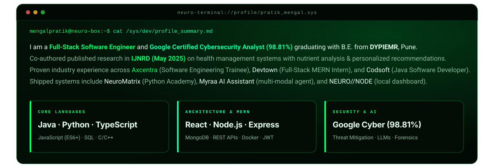



  <a href="https://github.com/mengalpratik/NeuroMatrix">
    
  </a>

  <a href="https://github.com/mengalpratik/myraa-ai-assistant">
    
  </a>

  <a href="https://github.com/mengalpratik/NeuroStore-mern-Ecommerce">
    
  </a>

  <a href="https://github.com/mengalpratik/Axcentra-Internship-Work-2026">
    
  </a>





  <a href="https://github.com/mengalpratik">
    
  </a>


  <a href="https://www.linkedin.com/in/pratikmengal-/">
    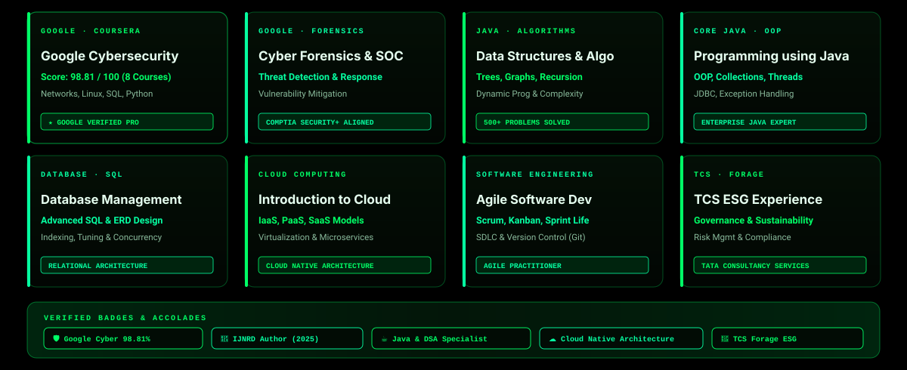
  </a>

  
  
  
  
  
  

  

  

